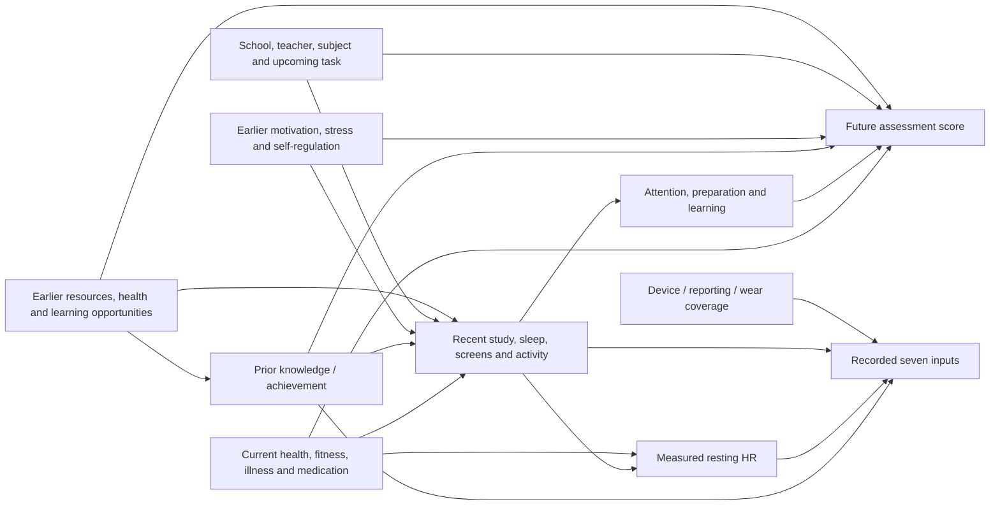

# TwinTrack scientific foundation and final research synthesis

Research updated **6 October 2026**. I reviewed public literature and the existing project evidence to challenge, not validate by assertion, TwinTrack's rationale. This is a research-only update: no iOS/model changes, retraining, participant analysis or private-data access. **NetHealth remains the only completed TwinTrack participant-level comparison; HSLS is pending, MCS planning and COMPASS candidate research.**

This existing synthesis serves as the requested scientific-foundation report. Read it with the [seven-input matrix](TWINTRACK_INPUT_EVIDENCE_MATRIX.md), [future validation protocol](TWINTRACK_FUTURE_VALIDATION_PROTOCOL.md) and [presentation/website/CV/judge claims](PRESENTATION_RESEARCH_CLAIMS.md). Exact research findings are separated from interpretation; the complete search and access limits are in section 22.

## 1. Executive summary

**TwinTrack is defensible as an evidence-informed experimental engineering and reflection prototype. Its current seven-input V2 is not scientifically validated for predicting real students' upcoming scores.** Prior achievement has strong predictive support. Study minutes, sleep duration and recreational screen minutes have mixed evidence; Apple Exercise Time and steps have weak direct academic support; resting HR remains exploratory. No review finding establishes the seven coefficients or their incremental value in UAE Grade 12 students.

The strongest challenge is the completed NetHealth comparison: wearables added effectively no predictive value beyond prior performance. That result remains unchanged. The most useful next study would prospectively compare frozen V2 with a previous-score baseline on actual same-subject assessments, with calibration, coverage and uncertainty. Additional supportive citations cannot replace that test.

The current model remains **Ridge V2 2.0-final.1, alpha=0.1**, standardized, deterministic and synthetic-trained. Its ordered features remain `sleep_hours`, `steps`, `exercise_minutes`, `resting_heart_rate`, `study_minutes`, `screen_time_minutes`, `previous_score`. Subject/assessment/date metadata are eligibility/context, not extra coefficients. Optional RHR wellbeing and BMI do not enter the academic model.

This package is sufficient to support a carefully qualified graduation-project research defense, not a guarantee about an unseen marking rubric. The appropriate public wording is **“digital-twin-inspired student reflection prototype.”** Software correctness, scientific validity and user usefulness are three separate evidence questions.

## 2. Frozen NetHealth result and consistency review

Source: local-only `NetHealth_Final_Report.md`, SHA-256 `8c1b17ef20c1ca5f9f909b643c9ddaacd9991dcb3018630677430876e7abcfdb`. Reviewed, not altered or rerun. This is a consistency review of the saved report, not an independent replication: its referenced panel, fold-results CSV and exclusion file are not present in the approved research folder.

**Population and design.** A single Notre Dame undergraduate cohort; 207 unique students and 963 student-semester observations across seven target terms. There were 1,483 eligible transitions among 215 linked students; 520 transitions were excluded, with 64.9% retained. The 963 rows are not independent students. The outcome is the unweighted mean course grade points on a 0–4 scale, not official credit-weighted GPA or a single upcoming test percentage. Baseline A uses previous-term course-grade average. B adds first-28-day average sleep, steps, active minutes/MVPA and **average daily heart rate**, not resting heart rate. Study and screen time were absent.

At least 14 sleep days, 14 activity days and three prior courses were required. The report records ten repeated five-fold student-grouped validations, training-only scaling/nested grouped alpha selection, and identical A/B rows. Its paired bootstrap resampled 207 students with all their rows together, for 10,000 replicates.

**Main numerical results, preserving their estimands:**

| Metric | Model A, mean across 50 folds | Model B, reconstructed from rounded A + delta | Reported fold-mean B−A |
| --- | ---: | ---: | ---: |
| MAE (grade points) | 0.17127 | approximately 0.17130 | +0.00003 |
| RMSE (grade points) | 0.23888 | approximately 0.23941 | +0.00053 |
| R² | 0.52495 | approximately 0.52314 | −0.00181 |

B values in this table are arithmetic reconstructions from the saved rounded numbers, **not recovered exact source table values**. Positive error deltas mean worse prediction.

The separately reported paired student-cluster bootstrap intervals are ΔMAE [−0.00112, +0.00099], ΔRMSE [−0.00050, +0.00140], ΔR² [−0.00503, +0.00209]. They concern pooled prediction statistics, not interchangeable fold-average estimates. The pooled MAE point delta is reported as −0.00006, opposite the tiny fold-mean +0.00003. Do not silently attach a pooled interval to a fold-average point estimate as one identical estimator.

| Separately reported pooled/bootstrap quantity | A | B |
| --- | ---: | ---: |
| MAE | 0.17105 [0.15573, 0.18826] | 0.17098 [0.15552, 0.18836] |
| RMSE | 0.23939 [0.21070, 0.27497] | 0.23983 [0.21103, 0.27572] |
| Pooled out-of-fold R² | 0.54504 | 0.54292 |

Rounded pooled MAEs subtract to −0.00007, while the report gives −0.00006 from its calculation; retain this rounding distinction. A had higher pooled R² in nine of ten repetitions. None of these variations provides convincing wearable improvement.

**Robustness.** Reported B−A triples (MAE, RMSE, R²): OLS (+0.00003, +0.00054, −0.00182); term fixed effects (+0.00016, +0.00060, −0.00208); longest-bout sleep (−0.00025, +0.00027, −0.00077). Wearables-only diagnostic R² was −0.013. The prior-performance standardized coefficient was +0.262; wearable magnitudes were at most 0.013 in the descriptive full-sample fit. The preregistered joint improvement rule was not met.

**Reporting corrections for future summaries, without editing the frozen report:**

- Do not repeat “less than 0.1% on every metric.” The reported RMSE change is about 0.22% of A's fold-average RMSE; ΔR² is −0.181 percentage points. Use raw deltas.
- “All four secondary specifications” conflates three A/B robustness comparisons with a fourth, behavior-only diagnostic. Describe them separately.
- “Zero of three conditions” refers to the fold-mean decision framing; the tiny pooled MAE has the other sign. The overall gate still fails. Do not present either tiny sign as substantive evidence.
- Some originally promised tables/attachments are absent from the saved narrative. Exact fold-level reconstruction and independent interval verification require those original aggregate outputs; no rerun or methodological invalidity is inferred merely from missing attachments.

**Limitations.** Restricted grade range/ceiling, single high-achieving institution, compliance selection, attrition, repeated observations, inferred semester-code timing, summed-bout sleep including naps, no resting HR and no study/screen variables. No formal power analysis establishes sensitivity to very small effects. There is no causal identification. The result is “no convincing increment here,” not proof that sleep/activity never matter.

## 3. HSLS:09 — pending, not completed

The official audit supports a 2009→2012 mathematics question using `X1TXMTSCOR` → `X2TXMTSCOR`, with `S1HRMHOMEWK`, `S1HRTV`, `S1HRVIDEO`, `S1HRONLINE` as baseline behavioral proxies. Schoolday hour bands are not yesterday's exact minutes; math assessment T scores are not TwinTrack assessment percentages. The audited waves do not supply sleep duration, steps, exercise minutes or RHR. Extracurricular hours cannot substitute for exercise.

Public access exists, but the student codebook suppresses `SCH_ID`; survey weights do not supply a lawful school identity for group splitting. No participant file or authorized secure/restricted environment was available locally. **Analytic sample N, model metrics, coefficients and incremental result: PENDING / NOT ESTIMATED.** Public release counts must not be presented as our analytic sample. [NCES access](https://nces.ed.gov/surveys/hsls09/hsls09_data.asp), [student codebook](https://nces.ed.gov/pubs2015/2015036_student.pdf).

Local artifacts now contain the full field/access audit, frozen v1.0 protocol, hash manifest and execution template. The fixed plan compares weighted Ridge A (earlier math only) and B (same baseline plus four categorical behaviors), identical rows, nested school validation, survey-weighted metrics and explicitly conditional BRR uncertainty. It excludes imputed assessment targets and forbids outcome-driven specification changes. No transcript outcome switch, public student-fold substitution or model retuning is permitted without a new prospective amendment. [NCES design/weights](https://nces.ed.gov/pubs2014/2014361.pdf), [variable list](https://nces.ed.gov/pubs2014/2014361_2.pdf).

This is a **local preanalysis freeze**, not external registration. Documentation contains public descriptive information, and a public GPA/time-use search snippet was incidentally seen during discovery; the plan is not claimed literature-blind. No participant data or TwinTrack HSLS outcome analysis was examined before freezing it.

## 4. MCS status

**PLANNED / HISTORICAL RESEARCH EXISTS; NO COMPLETED TWINTRACK PARTICIPANT-LEVEL ANALYSIS.** The original research-plan file remains unavailable locally. The strategy document is a research/acquisition proposal, not a result. Neither missing plans nor descriptions of published MCS studies count as a TwinTrack experiment. No MCS effect size or model result is asserted here; recovering that plan is not required to finish this synthesis.

## 5. COMPASS status and external literature

**CANDIDATE / RESEARCHED; NO COMPLETED TWINTRACK PARTICIPANT-LEVEL ANALYSIS.** Separately, published research by Papasideris et al. (2021) analyzed 9,898 linked Canadian adolescent cases and described physical-activity/academic associations as trivial or effectively null. That is an external paper, not our analysis and not an out-of-sample V2 evaluation. Its self-reported grade/activity constructs differ from NetHealth and Apple Health. The paper's correction concerns references/citations and does not provide new TwinTrack results. [Original study](https://journals.plos.org/plosone/article?id=10.1371/journal.pone.0253142), [correction](https://journals.plos.org/plosone/article?id=10.1371/journal.pone.0259618).

## 6. Final V2 evidence alignment

Authoritative design: [V2 final blocker resolution](V2_FINAL_BLOCKER_RESOLUTION.md), final artifact `ml/v2/2026-09-21-final/results/new_ridge_seven_parameters.json`, SHA-256 `62cb14d443221f9f2e426280ebdf52d7ef8614812a89ef5031329642ff040024`. Earlier candidate reports are superseded for final numerical interpretation. The final assumption ledger explicitly separates modeling assumptions from empirical estimates.

V2 targets the next same-subject individual written quiz/test/exam percentage, 1–7 local days ahead; prior comparable assessment is 1–90 days old. Study/screen are yesterday's subject study/recreational totals; steps/exercise are previous-day totals; sleep uses the current completed/cutoff noon window; RHR is the latest valid sample within 72 hours. Those windows are product/development choices, not validated predictive horizons. Requiring seven available inputs is a product rule, not evidence that all seven are scientifically necessary.

Published synthetic evaluation: final 4,000-row set MAE 6.5346049, RMSE 8.1508881, R² 0.580072282; matched prior-only MAE 6.57051485. Difference about −0.03591 synthetic percentage points. These are **simulator results only**, not real-student accuracy, calibration or causal evidence. V1 comparisons on that synthetic distribution do not establish real-world V2 superiority. Nothing was retrained or rescored in this synthesis.

Qualitative alignment is strongest in emphasizing prior performance and keeping lifestyle increments restrained. Synthetic coefficient signs and stability partly reflect assumptions used to generate targets; they are not independent confirmations from new students. NetHealth influenced the rationale, so describing it as independent external validation of the resulting V2 would be especially inappropriate.

## 7. Seven-input evidence: what changed after the deeper review

The [input evidence matrix](TWINTRACK_INPUT_EVIDENCE_MATRIX.md) is the detailed source-and-effect ledger. Its ratings concern academic evidence for each measured construct, not health benefits and not a certification of the fitted V2 coefficient. All seven exact coefficients and deployed forecasting windows remain unvalidated in the target population.

| Input | Review judgment | Most important distinction |
| --- | --- | --- |
| Previous score | **STRONG SUPPORT** for later achievement level | Predicting rank/level is different from predicting improvement. |
| Study minutes | **MIXED / INCONSISTENT** | Learning strategy, completion and focused effort are not elapsed time. |
| Sleep hours | **MIXED / INCONSISTENT** | Duration is not quality, regularity, timing or sleepiness. |
| Recreational screen minutes | **MIXED / INCONSISTENT** | Purpose, activity, timing and displacement matter; total screens and problematic use differ. |
| Exercise minutes | **WEAK DIRECT SUPPORT** for the Apple field | School activity interventions and fitness are not Apple Exercise Time. |
| Steps | **WEAK DIRECT SUPPORT** | Ambulatory volume is an exploratory proxy; direct academic evidence includes a large prospective null. |
| Resting heart rate | **INSUFFICIENT DIRECT EVIDENCE** for a dependable academic predictor | Direct studies exist but are small/inconsistent; HRV, sleeping HR and average daily HR cannot substitute. |

**Source results:** prior attainment is strongly stable across school years; duration-only homework and screen findings vary; sleep-duration meta-analyses disagree in magnitude; exercise trials include benefits and nulls. The October 2026 prospective ABCD step paper found no main academic association. A directly relevant 2024 secondary-school RHR study was null. Sources, ages, outcomes, effect sizes and access limitations are recorded in the matrix.

**My interpretation:** these are reasonable *research candidates*, with substantially unequal support. Retaining seven frozen features preserves the experimental comparison; it does not demonstrate that every feature is necessary, useful or correctly weighted. Literature supports exploring a construct, not importing a published association as TwinTrack's coefficient. No literature-derived target for sleep, steps, screens or RHR should be used to optimize a student's predicted grade.

### Prior performance and study quality

Prior-score dominance is expected, not embarrassing: previous attainment summarizes accumulated knowledge, educational opportunity and persistent conditions. It remains an imperfect, sometimes noisy reference. [Rimfeld et al. (2018)](https://doi.org/10.1038/s41539-018-0030-0) support stability; [Simonsmeier et al. (2022)](https://doi.org/10.1080/00461520.2021.1939700) distinguish strong prior-to-later knowledge level from inconsistent gains. Neither establishes fixed potential. NetHealth aligns with this broad pattern, while testing a different target and population.

Specific study strategies have more directly interpretable learning evidence than a raw-minute dose. [Agarwal, Nunes and Blunt (2021)](https://doi.org/10.1007/s10648-021-09595-9) reviewed 50 classroom retrieval-practice experiments, N=5,374; 57% of effects were medium/large. Twenty experiments were K–12, 20 undergraduate and 10 medical-school; only 6% were in non-WEIRD settings. [Dunlosky et al. (2013)](https://doi.org/10.1177/1529100612453266) rated practice testing and distributed practice highly. These findings concern how learning is organized; they do not prove strategies predict *grades* better than minutes in the same held-out dataset. Deliberate, focused practice, feedback, spacing, metacognitive monitoring and task completion remain largely unmeasured by `study_minutes`. More time can also indicate difficulty, distraction or cramming; diminishing returns are plausible, with no universal optimum established.

## 8. The larger educational system and omitted variables

This is a ranking of **research relevance**, not a recommendation to add sensitive inputs or a pooled causal effect ranking. Different constructs, populations and outcomes prevent a numerical league table.

| Priority | Omitted category | Source result and implication |
| --- | --- | --- |
| 1 | Prior knowledge/cognitive skills beyond one previous mark | [Roth et al. (2015)](https://doi.org/10.1016/j.intell.2015.09.002): 240 samples, N=105,185, corrected ability–grade correlation .54. Abstract verified; CI unavailable. A corrected latent association is not held-out R² or destiny. |
| 2 | Instruction, attendance, curriculum, subject and assessment difficulty | [Liu, Lee and Gershenson (2021)](https://doi.org/10.1016/j.jpubeco.2021.104441) use within-student/between-subject comparisons of secondary absences; fewer attended lessons relate to poorer outcomes under identification assumptions. [Tao et al. (2022)](https://doi.org/10.1080/01443410.2022.2033168): 71 papers, perceived teacher support r=.16; this is not a measure of teacher quality. |
| 3 | Learning strategies, engagement, homework completion, self-regulation | [Wong et al. (2024)](https://doi.org/10.1037/edu0000833): 137 elementary/secondary studies, N=158,510, engagement–achievement r=.33 (abstract; CI/I² not verified). Engagement is broader than time spent and may be reciprocally related to success. |
| 4 | SES, parental education, resources and school opportunity | [Liu et al. (2022)](https://doi.org/10.1007/s10648-022-09689-y): two large primary/secondary syntheses, correlations approximately .22–.28; samples overlap conceptually and should not be added as unique people. Resources can influence both behaviors and grades. |
| 5 | Motivation, self-efficacy, conscientiousness and procrastination | [Talsma et al. (2018)](https://doi.org/10.1016/j.lindif.2017.11.015): 11 longitudinal studies, N=2,688; prior achievement→efficacy was stronger than the reverse; child findings did not support the reverse path. [Meyer et al. (2023)](https://doi.org/10.1007/s10648-023-09736-2): 78 studies, N=500,218; personality associations depend on subject and grade/test measurement. [Kim and Seo (2015)](https://doi.org/10.1016/j.paid.2015.02.038): 33 studies, N=38,529, negative procrastination association sensitive to measurement. These are not automatic causal levers. |
| 6 | Health, mental health, stress, learning needs and family demands | Important possible common causes and effect modifiers; sleep/school longitudinal evidence supports bidirectionality, not a diagnosis from wearable values. This review does not assign a universal coefficient to these constructs. |

Sources in this table were read at original abstract level except Meyer (full text), with the Liu attendance working paper also available; unverified CIs and heterogeneity are not supplied. First-person evidence notes describe this review, not a claim that A independently conducted the cited studies.

Self-regulated learning offers a useful **theoretical lens**: planning, monitoring and adjusting one's work are different from accumulating time. Habits and procrastination affect when work happens; attention and cognitive load affect what can be learned during it. TwinTrack records a few observable signals around these processes, not motivation, metacognition or a complete psychological state. Inferring such traits from steps or RHR would be unsupported. A limited engineering prototype is legitimate if its boundaries are explicit; omission prevents a claim to explain all causes of achievement.

## 9. UAE/GCC evidence and transfer

**Global evidence** supplies most of the feature literature. **UAE evidence** gives context, not direct V2 validation. [OECD's PISA 2022 UAE note (2023)](https://www.oecd.org/en/publications/pisa-2022-results-volume-i-and-ii-country-notes_ed6fbcc5-en/united-arab-emirates_74e92cf9-en.html) covers 24,600 15-year-olds in 840 schools; the top/bottom SES-quartile mathematics gap was 68 PISA points. These are population descriptions, not a wearable coefficient or a next-test percentage.

[Arora et al. (2025)](https://doi.org/10.1038/s41598-025-90720-x) studied 158 UAE female university students with actigraphy; sleep regularity did not significantly relate to academic performance. This is an important local null, but regularity is not duration and university women are not Grade 12 students. [Sohail et al. (2024)](https://doi.org/10.3390/ijerph21091187) surveyed 304 UAE school adolescents; its home-food-environment regressions cannot be repurposed as a validated sleep/activity academic model.

**GCC is not UAE:** Saudi adolescent screen findings include both a weak negative association and an adjusted association in the opposite direction (matrix). Saudi RHR/activity research without academic outcomes supplies physiological context only. This targeted search did not establish high-quality UAE adolescent evidence that the exact wearable fields add accuracy beyond prior marks. That is a search limitation, not proof that no such research exists.

Age, puberty, language, curriculum, school resources, assessment type, weather/activity routines, device access and grading practices can affect transportability. No country-specific cultural explanation is asserted as the reason for any null. Source validity must be assessed before local branding is treated as local validation.

## 10. Measurement relevance is not measurement quality

| Input | Theoretical relevance | Actual measurement and important error |
| --- | --- | --- |
| Previous score | Strong attainment reference | Manual earned/maximum score can be mistyped, recalled incorrectly or drawn from a noncomparable assessment. Same subject improves alignment but does not equalize difficulty. |
| Study minutes | Preparation/opportunity proxy | Recall, rounding, multitasking, task difficulty and social desirability; duration omits strategy and focus. Academic screen use is study, not recreation, under the product definition. |
| Recreational screen minutes | Possible distraction/displacement context | Manual purpose classification; simultaneous devices/activities can double-count elapsed time; logged device totals would still not perfectly reveal purpose. |
| Sleep hours | Recent sleep-duration signal | Device-estimated asleep time is not PSG, quality or regularity. Wear coverage, naps, multiple sources and algorithm updates matter. |
| Steps | Ambulatory volume | Gait, speed, arm movement, device location and source aggregation affect counts. Activity intensity/fitness remain unmeasured. |
| Exercise minutes | Credited activity duration | Apple's algorithmic Exercise Time is not equivalent to total workout duration or every research definition of MVPA. |
| RHR | Exploratory physiological context | Latest vendor/source-defined RHR differs from clinic seated HR, sleeping HR, all-day mean HR and HRV. Age, illness, medication, time, posture and fitness can affect it. |

**Manual measures:** [Parry et al. (2021)](https://doi.org/10.1038/s41562-021-01117-5), 106 effects, found only moderate agreement between self-reported and logged digital-media use; no precise coefficient is reproduced from the abstract. [Kuncel, Credé and Thomas (2005)](https://eric.ed.gov/?id=EJ737276), N=60,926, found self-reported grades' validity varied with achievement/ability. This motivates checking record accuracy in a future consented study, not reading private records now.

**Wearable evidence:** [Lambe et al. (2026), Apple Watch living review](https://doi.org/10.1038/s41746-025-02238-1) included 82 studies across 14 metrics, but only three qualifying step studies on early hardware. Its enormous overall N cannot be assigned to sleep or steps. [Schyvens et al. (2025)](https://doi.org/10.1093/sleepadvances/zpaf021) found Apple Series 8 total-sleep bias +19.60 minutes and mean absolute error 27.75 minutes in 20 successful adult recordings, with 15 Apple failures. One-night adult data do not establish current adolescent performance.

[Kwon et al. (2021)](https://doi.org/10.3390/s21196413) found Apple Watch 3 MVPA agreement much better in simulated conditions than a tiny free-living sample: in five children, Apple averaged 78.6 versus ActiGraph 53.3 minutes/day, MAPE 47.5%. The comparison device is not a perfect free-living gold standard. [Warner et al. (2025)](https://doi.org/10.1177/20552076251326225) found native Exercise credit at 33% VO₂ reserve (95% HDI 31–36) in 74 adults, below the study's 40% moderate-intensity criterion. These studies challenge construct equivalence, not exercise's health value.

Heart-rate measurement can agree well under some conditions: [de Zambotti et al. (2016)](https://doi.org/10.1016/j.physbeh.2016.03.006), 32 adolescents, compared Fitbit overnight HR with ECG. This does not validate Apple's latest RHR or grade prediction. [Speed et al. (2023)](https://doi.org/10.1371/j.pdig.0000236), 433 active adults, found different daytime/nighttime rest-based HR estimates; device funding and operational definitions matter. No generic “wearables are accurate” verdict follows.

Apple's [Exercise measurement description](https://support.apple.com/en-sg/105002) and [2025 sleep-stage white paper](https://www.apple.com/health/pdf/Estimating_Sleep_Stages_from_Apple_Watch_Oct_2025.pdf) explain algorithms and version changes, not independent academic validity. HealthKit can combine permitted sources; it is not necessarily a watch-only record. A valid sensor measurement and a valid academic forecast are separate requirements.

## 11. Target and time-window validity

`assessment_score` means one upcoming, individual, same-subject written quiz/test/exam percentage. It is not GPA, standardized ability, general intelligence, attendance or wellbeing. Context metadata helps establish eligibility and interpretation; it does **not** make the seven-coefficient function subject-specific or adjust for exam difficulty.

[Brookhart et al. (2016), A Century of Grading Research](https://doi.org/10.3102/0034654316672069) describe grades as multidimensional, affected by grading practices and task selection. **Inference for TwinTrack:** equal percentages from different teachers/tests need not represent equal mastery. One previous mark and one future test can be noisy; earned/max conversion does not equate exams. Subject matching is more coherent than an unspecified grade target, but still needs validation by subject, exam type, difficulty and horizon.

| Frozen contract | Evidence status |
| --- | --- |
| Upcoming assessment 1–7 local days away; prior comparable mark 1–90 days old | **PRODUCT ASSUMPTION**, not an empirically validated forecast/retention window. |
| Study and recreational screen time: previous local day | **PRODUCT ASSUMPTION**; research often measures typical weeks, term habits or categorical homework. |
| Steps/Exercise Time: previous completed local calendar day | **PRODUCT ASSUMPTION**; no demonstrated sufficiency for near-term academic forecasting. |
| Sleep: yesterday local noon to earlier of now/today noon; union of asleep intervals including naps | **PRODUCT ASSUMPTION**; not automatically identical to research school-night duration. |
| Latest finite positive RHR within 72 elapsed hours, retaining timestamp | **PRODUCT ASSUMPTION**; latest does not mean same-day or habitual baseline. |

[Cousins et al. (2019)](https://doi.org/10.1016/j.jadohealth.2019.04.030) tested 59 adolescents aged 15–18 across five nights of 5 versus 9 hours of sleep opportunity, finding poorer retention of taught factual material under restriction. This experimental contrast supports some learning mechanisms, not ordinary school grades or this combination of windows. Multiweek sleep associations in [Creswell et al. (2023)](https://doi.org/10.1073/pnas.2209123120), five first-year-college samples/N=634, cannot establish a one-window teen forecast. Cohort overlap must be checked before calling university wearable studies independent of NetHealth. Health guidance such as [AASM's teen sleep recommendation](https://aasm.org/advocacy/position-statements/teen-sleep-duration-health-advisory/) and [WHO's 2020 activity guideline](https://www.who.int/publications/i/item/9789240015128) is not an academic optimum or a prescription in Apple Exercise minutes.

## 12. Ridge, scaling and coefficient interpretation

Ridge is a defensible simple reference model for a small tabular prototype. It minimizes squared residuals plus an L2 penalty, trading some bias for coefficient stability. Correlated inputs can share signal; shrinkage does not eliminate confounding or guarantee external accuracy. With frozen parameters, inference is a small deterministic calculation suitable for on-device implementation. Alpha **0.1** is the current development choice, not a literature-established optimum. [Official Ridge definition](https://scikit-learn.org/stable/modules/generated/sklearn.linear_model.Ridge.html).

Standardization uses **training** means and standard deviations: `z_j = (x_j − mean_j) / sd_j`. This makes the penalty operate on comparable input scales rather than arbitrary units such as steps versus hours. It does not make the data normally distributed or remove correlations; training statistics must be reused at inference. [StandardScaler documentation](https://scikit-learn.org/stable/modules/generated/sklearn.preprocessing.StandardScaler.html).

| Alternative | Honest comparison with Ridge |
| --- | --- |
| Mean / previous-score baseline | Essential low-complexity competitors; a complex app must show value beyond an already informative mark. |
| OLS | Simple and transparent; no shrinkage, potentially less stable with correlated/noisy predictors. |
| Lasso / Elastic Net | Can select/shrink coefficients; selection among correlated features and tuning can be unstable. Worth future same-fold comparison, not automatic superiority. |
| Random forest / gradient boosting | Can represent nonlinearities/interactions; need careful tuning, enough real outcomes and leakage-safe comparison. |
| Neural network | Adds complexity without a demonstrated need for this seven-input small-data problem; no assumption it will improve performance. |

[Grinsztajn, Oyallon and Varoquaux (2022)](https://proceedings.neurips.cc/paper_files/paper/2022/hash/0378c7692da36807bdec87ab043cdadc-Abstract-Datasets_and_Benchmarks.html) found tree advantages over deep learning on their tabular benchmark; that is not evidence that Ridge is best for TwinTrack. No new benchmark was run because synthetic outcomes would mostly reward agreement with their generator.

**Interpretation:** a coefficient describes a conditional response of the fitted function, holding its other inputs fixed. Away from output clipping, changing one raw input by Δx changes the linear score by `coefficient_j × Δx / sd_j`; the deployed output range can truncate that change. Standardized magnitude is not universal feature importance: it depends on covariance, scaling, penalty, sampling and the synthetic target generator. It cannot rank causal leverage. A negative step coefficient is not advice to walk less. A small real-data association does not justify importing a fixed linear slope into all students or extrapolating outside development ranges.

## 13. Synthetic data and the three kinds of validation

Assumption-generated profiles are useful for feature-order/scaling checks, numerical parity, missing-input handling, boundary cases, persistence, UI integration and privacy-conscious demonstrations. They provide known inputs and repeatable expected outputs. They cannot estimate actual student error, subgroup fairness, calibration, grade benefit or a biological mechanism. A holdout drawn from the same assumptions can confirm generator generalization while leaving the assumptions false in real life.

[Decruyenaere et al. (2024)](https://proceedings.mlr.press/v244/decruyenaere24a.html) show inferential risks when generated synthetic samples are treated like observed data. Their generative-data setting is not identical to TwinTrack's assumption-led simulator. **My inference:** an additional synthetic sample cannot supply the missing independent educational evidence. Real-data-derived synthetic data can also retain privacy risks; “synthetic” alone is not a privacy guarantee.

| Validation | What evidence can establish | TwinTrack status |
| --- | --- | --- |
| Engineering | Tested code behavior, deterministic parity, persistence and workflows within the exercised cases | Existing software checks; see [app ledger](FINAL_APP_PASS.md). No tests/build were rerun for this documentation-only review. Passing tests are not a proof of all possible behavior. |
| Scientific | Out-of-sample error, calibration, incremental value and transportability in a defined population | NetHealth proxy comparison completed; **current V2 real-student predictive validity unverified**. |
| User | Comprehension, usability, appropriate trust and usefulness under real tasks | A's physical reviews are useful development feedback, not a representative student user study or proof of improved grades. |

Historical V1 used StandardScaler/Ridge alpha=10, 1,000 synthetic rows, seed 42, 800/200 split and five-fold CV; holdout MAE≈4.76146, RMSE≈5.86837, R²≈.57043. These are **historical synthetic results**, not current V2 metrics and not real accuracy. V2 numbers are separately labeled in section 6. No synthetic residual spread can honestly be relabeled as an individual student's confidence range.

## 14. Association, prediction and causation

**Association:** students reporting longer sleep may have different marks. **Prediction:** the measured sleep input improves a preregistered held-out forecast beyond prior score. **Causation:** changing sleep by a defined intervention changes the later outcome. Evidence for one does not establish the others. A causal factor may add little prediction once its correlates are known; a useful predictor may not be a modifiable cause. [Shmueli (2010), To Explain or to Predict?](https://doi.org/10.1214/10-STS330).

**CONCEPTUAL CAUSAL MAP — illustrative hypotheses, not a proven complete graph.** Arrows run forward to avoid confusing future feedback with same-time causation; most variables are omitted from Ridge. Prior performance can alter later behavior, and current outcomes can influence the *next* cycle (not drawn).

RHR has no asserted direct causal arrow to grades here: it may be a marker of other processes. The graph is not an adjustment recipe or a proof that all arrows exist. Wear time and manual reporting can select which profiles are observed. Time is also constrained: adding an hour of studying replaces something else. A one-input slider can describe an implausible joint profile if sleep, study and screens overlap or compete.

**What-If is model sensitivity / scenario analysis.** It reruns the same function on edited inputs. It neither identifies a `do(intervention)` effect nor searches a validated causal recourse policy. Formal counterfactual explanations and feasible interventions require additional assumptions about causal relationships, as discussed by [Karimi, Schölkopf and Valera (2021)](https://arxiv.org/abs/2002.06278). Safe wording: “See how the frozen model's estimate changes under a hypothetical input scenario.” Avoid “find out how much your grades will improve.”

## 15. Preserve NetHealth's null; test explanations rather than inventing them

The broad educational literature makes strong prior-performance prediction plausible. It does not prove why the wearable increment was null. Every entry below is **PLAUSIBLE EXPLANATION / NOT ESTABLISHED BY THIS STUDY**.

| Hypothesis | What would be needed to test it |
| --- | --- |
| Prior achievement captures persistent information also reflected in wearables; effects may be mediated/collinear | Separate a prediction question from a prespecified causal estimand; compare group contributions on common held-out rows. |
| Measurement noise or mismatched duration/HR constructs weakened signal | Criterion/coverage sensitivity analyses with permitted measurements; do not assume sensor accuracy fixes prediction. |
| Early-term averaging missed outcome-relevant windows or diluted within-person dynamics | Prospectively chosen windows and longitudinal labels; no outcome-selected window search on final test data. |
| Restricted grades, behavior variation, compliance selection or domain mismatch limited detectable increment | Report distributions, exclusions, transport tests and uncertainty; do not relabel the cohort as representative. |
| Sample precision was insufficient for very small effects | A planned cluster-aware precision analysis; 963 rows are not 963 independent participants. No “well-powered” claim. |
| There genuinely is little useful wearable increment for this forecasting task | Accept this possibility and compare simpler models; a null cannot be discarded because a mechanism sounds plausible. |

No amount of supportive cognition or fitness literature overturns an observed incremental-prediction result. Conversely, a null grade increment does not negate wellbeing benefits. Original aggregate NetHealth outputs would improve independent reproducibility if recovered, but no rerun is authorized or necessary to preserve its documented conclusion.

## 16. Digital-twin terminology and personalization

The [National Academies (2024)](https://doi.org/10.17226/26894) emphasize a dynamic representation, real-world updating, prediction/decision value and feedback, with validation and uncertainty. A 3D avatar and continuous per-person retraining are not necessary. [Kritzinger et al. (2018)](https://doi.org/10.1016/j.ifacol.2018.08.474) offer a stricter manufacturing model/shadow/twin distinction by data flow; that taxonomy is useful but not universal. [Gaffinet et al. (2025)](https://doi.org/10.1016/j.compind.2024.104230) find human-twin definitions and feedback boundaries unsettled.

**My assessment: PARTLY.** TwinTrack maintains individual inputs and supports hypothetical scenarios, but has not validated an updated, outcome-linked representation of an individual learner. The best public phrase is **“digital-twin-inspired student reflection prototype.”** “Scoped student digital-twin prototype” is acceptable when the scope and unvalidated shared model are explained. It is not a full student replica, causal habit simulator, clinical twin or educational decision authority. Education-specific conceptual architectures exist, but synthetic demonstrations are not proof of effectiveness: [Kabashkin (2025)](https://doi.org/10.3390/info16100846) explicitly describes a framework without institutional empirical deployment.

Personal data changes an output; that is not the same as learning personal coefficients. The separate RHR wellbeing baseline compares someone with their own recent observations; it does not personalize the academic response function. [Curran and Bauer (2011)](https://doi.org/10.1146/annurev.psych.093008.100356) explain why between-person associations can differ from within-person change. [Fisher, Medaglia and Jeronimus (2018)](https://doi.org/10.1073/pnas.1711978115) demonstrate that group and individual relationships need not agree. Neither says global predictions always fail.

Future research should test both new-student generalization and future outcomes for existing students. A hierarchical model can share information while allowing individual differences; an independent student model needs many informative, temporally ordered **academic outcomes**, not merely thousands of sensor readings. Personal models are not automatically superior: [Soyster et al. (2022)](https://doi.org/10.1037/adb0000666) found pooled/multilevel advantages for some outcomes in a small intensive adult alcohol study. That is a methodological counterexample, not educational evidence. No personalized model is recommended for implementation now.

## 17. Missingness, uncertainty, calibration and selection

An observed zero activity duration is different from no accessible reading. Keeping required missing inputs unavailable avoids silently inventing observations. Apple's [HealthKit privacy documentation](https://developer.apple.com/documentation/healthkit/protecting-user-privacy) explains that denied read access can look like absent data; absence cannot reliably be labeled a permission refusal. Abstention is honest, but seven-input completeness can exclude people systematically and must be evaluated as part of performance.

[Missing-data guidance from Sterne et al. (2009)](https://doi.org/10.1136/bmj.b2393) explains why complete-case or imputed analyses need assumptions; observed data alone cannot settle missing-at-random versus missing-not-at-random. Future imputation, partial models or missingness models would require training-only estimation, deployment-compatible inputs, uncertainty and subgroup evaluation. None is being added. Report coverage for all eligible attempts, not only error among successful predictions.

A future prediction interval could be more informative than a precise-looking decimal, **if calibrated on independent real outcomes**. A confidence interval for mean error is not an interval for one student's score. [Angelopoulos and Bates (2021, revised 2022)](https://arxiv.org/abs/2107.07511) explain conformal prediction's marginal coverage under exchangeability; this is not guaranteed coverage for every student or subgroup, and ordinary assumptions fail under some time/group shifts. Synthetic calibration cannot fill the gap.

Future validation needs observed-versus-predicted plots, mean bias, calibration intercept/slope, residuals by score range/horizon, error and interval coverage/width, and abstention rates. Good R² alone does not establish calibration. Clinical prediction guidance from [Riley et al. (2024)](https://doi.org/10.1136/bmj-2023-074820) is adapted here for statistical principles, not to label TwinTrack clinical or certified. Details are in the [future protocol](TWINTRACK_FUTURE_VALIDATION_PROTOCOL.md).

Device ownership and wear/consent completeness can select more affluent or health-engaged users. [Nagappan, Krasniansky and Knowles (2024)](https://doi.org/10.2196/56504), a US adult survey of 23,974, found income/education differences in wearable ownership. This establishes a plausible selection concern, not the prevalence of bias in UAE teenagers. Compare eligibility, coverage and errors across consented, justified groups where samples support it; do not infer sensitive characteristics or collect demographics merely to improve the score. Excluding SES from predictors does not automatically remove proxy bias.

## 18. Privacy, ethics, human factors and product value

Local processing, permission control, minimization and deletion are useful safeguards; they are not proof of legal compliance or zero privacy risk. Existing app design separates deterministic academic calculation from Foundation Models conversation and optional non-diagnostic wellbeing. This review does not certify every implementation path or Apple/system backup behavior. Detailed technical evidence remains in the app/privacy ledgers, not inferred from a literature paper.

For future research, use only consented minimum aggregates, retain them for a stated period, separate identities from study data and provide withdrawal/deletion procedures subject to the approved study plan. No raw Health records, private chats/photos or device identifiers are needed for this review. [UNICEF's Guidance on AI and Children 3.0 (2025)](https://www.unicef.org/innocenti/reports/policy-guidance-ai-children) emphasizes children's rights, agency, fairness, safety and privacy. [NIST AI RMF 1.0 (2023)](https://doi.org/10.6028/NIST.AI.100-1) separates trustworthy-system dimensions. These frameworks inform design; neither confers compliance.

**Material platform question before distribution:** Apple's cited HealthKit guidance requires an appropriate health/fitness purpose clearly reflected in UI/marketing. Permission and local processing alone do not settle whether every academic-prediction use meets that requirement. Review the actual purpose and current platform terms before public distribution; this report makes no violation finding, App Store approval claim or legal determination. No app behavior is changed here.

Predicted marks could anchor expectations, discourage effort, provoke anxiety or be misused for ranking and pressure. These are plausible risks to test, **not observed TwinTrack harms**. An experimental label and non-causal wording are sensible but not evidence that users understand them. Avoid positioning the score as ability, diagnosis, school grading, admissions advice or a reason to deny support. Keep safety/wellbeing guidance independent of optimizing the academic estimate.

[Kaliisa et al. (2024)](https://doi.org/10.1145/3636555.3636884), a 38-study learning-analytics dashboard review, found limited achievement benefits and substantial design/confounding limitations; dashboard use can reflect pre-existing engagement. A dashboard is not automatically an educational intervention. Test comprehension of saved/current data, uncertainty and What-If; examine appropriate trust, distress, usefulness and accessibility separately from prediction accuracy. Demonstrating grade improvement would require an additional causal effectiveness study.

**Product interpretation, not a market-uniqueness finding:** TwinTrack combines student-entered academic context, permitted wearable summaries, a transparent numerical model, scenario comparisons and conversation in one local reflection workflow. This differs in emphasis from a planner, generic health dashboard or general chatbot, but no exhaustive competitor study establishes uniqueness or demand. The strongest proposed value is helping users organize and question information; whether students find that useful remains testable.

## 19. Important blind spots and research priorities

| Finding / action | Practical value | Why it matters now |
| --- | --- | --- |
| Preserve NetHealth null; distinguish engineering/science/user validation; remove accuracy/causal overclaims | **VERY HIGH VALUE** | Central to credibility, presentation and defense. |
| Prior-score persistence baseline; frozen prospective target; independent real outcomes | **VERY HIGH VALUE** | Tests whether seven inputs add useful information at all. |
| Construct/time-window mismatch; selection and missingness; real calibration | **VERY HIGH VALUE** | Affects actual validity more than collecting supportive citations. |
| Subject/assessment comparability, participant/school/time leakage and uncertainty | **HIGH VALUE** | Prevents misleading performance from repeated or mismatched labels. |
| Child-centered comprehension/trust study; HealthKit purpose review before distribution | **HIGH VALUE** | Separates responsible usefulness and distribution readiness from a functioning demo. |
| Within-student versus between-student analysis, fair coverage, drift | **HIGH VALUE** for future research | Individual feedback needs longitudinal evidence; curricula/devices and behavior can change. |
| Richer study strategy or sleep timing research; hierarchical personalization | **MODERATE VALUE** now | Valuable future questions; not grounds to change a frozen model without real comparison. |
| Extra proxy-dataset names, more synthetic accuracy metrics, cosmetic “digital twin” arguments | **LOW VALUE** now | Do not close the primary validation gap. |

Additional blind spots: **measurement invariance** (the same reported minute or percentage means different things across tasks/devices); **feedback loops** (seeing a forecast changes studying and therefore the observed outcome); **observer effects** (logging changes habits); **drift** (watch software, exam difficulty, school schedule); **selective outcome reporting** (students enter favorable marks); **ceiling/clipping** (compressed errors and sensitivities at 0/100); **time-budget incompatibility** in hypothetical scenarios. These are hypotheses/risks requiring design checks, not discovered code defects. More sensor rows cannot compensate for few independent assessments or schools.

The next valuable research is the [prospective protocol](TWINTRACK_FUTURE_VALIDATION_PROTOCOL.md), not retrospective coefficient editing. HSLS remains a complementary, access-dependent homework/media question. Do not tune V2 against its eventual outcome or count that different target as app validation. No feature change, retraining, participant analysis or data collection was performed in this review.

## 20. Final synthesis

**A — Strongly supported:** prior attainment as an important later-level reference; separating learning quality from time; the need for fair baselines and independent validation; deterministic implementation as an engineering property.

**B — Plausible but uncertain:** study/sleep/screen context, student reflection value, and some activity-related learning mechanisms. Plausibility does not quantify individual grade change.

**C — Weakly supported:** steps and Apple Exercise Time as direct academic inputs; a dependable latest-RHR academic signal; meaningful joint wearable increment beyond prior score.

**D — Current limitations:** synthetic target/coefficient development, no prospective target-population V2 validation, coarse/noisy measures, unvalidated windows, omitted educational causes, selection, global rather than learned personal response and no real calibrated interval.

**E — Strongest scientific argument for TwinTrack:** a transparent, frozen, testable hypothesis with prior-achievement grounding and an openly reported real-data null can support a rigorous experimental prototype.

**F — Strongest scientific argument against its current predictive claim:** no independent real outcomes establish that the seven-input deployed mapping is more useful than simply using the last comparable mark; available project data did not show wearable increment.

**G — Why defensible:** a scoped engineering and research demonstration need not claim validated educational forecasting. Its value lies in implementation, critical evaluation, responsible boundaries and a falsifiable next study.

**H — What would validate it:** prospective frozen forecasts, meaningful baseline improvement with uncertainty, calibration/coverage, external replication and separate user-benefit evaluation. The possible outcome remains that the simpler model is preferable.

**I — Do not claim:** accurate student grades, causal habit gains, scientifically proven seven-input necessity, clinical inference, universal fairness, a complete student twin or completed HSLS/MCS/COMPASS participant studies.

**J — Next:** resolve study ethics/access, preregister the frozen prospective comparison, plan precision and verify outcome collection feasibility; conduct only after separate approval.

**K — Do not spend time on:** tuning to selected papers, rerunning synthetic data to manufacture validation, relabeling cognition as grades, adding inputs during freeze, or forcing positive interpretations of nulls.

## 21. Direct final verdict

| Question | Verdict |
| --- | --- |
| Are the seven inputs theoretically plausible? | **PARTLY** — coherent candidates, but RHR/steps have weak direct academic grounding and none of the exact deployed sensitivities is validated. |
| Are all seven equally supported? | **NO.** |
| Is previous score expected to be dominant? | **YES**, for later attainment level; not guaranteed for every subject/student or prediction of change. |
| Good evidence of wearable value beyond prior performance for this contract? | **INSUFFICIENT**; NetHealth's completed comparison found no convincing increment. |
| Is Ridge defensible? | **WITH QUALIFICATIONS** — simple and testable, not established as best or calibrated. |
| Synthetic data for engineering development? | **YES.** |
| Synthetic data sufficient for real-world validation? | **NO.** |
| “Student digital twin” defensible? | **PARTLY** — use “digital-twin-inspired student reflection prototype.” |
| “Evidence-informed experimental prototype” defensible? | **YES**, describing rationale and limitations, not empirical V2 accuracy or literature-derived coefficients. |
| Single biggest scientific weakness | No independent prospective validation of the deployed model against meaningful prior-score baselines in its target population. |
| Single strongest scientific strength | A transparent, falsifiable model rationale that preserves the completed negative real-data finding rather than hiding it. |

## 22. Search method, source access and completion boundary

I searched public publisher/author papers, PubMed/PMC, ERIC, official education/child-rights sources and Apple documentation on **6 October 2026**, prioritizing 2015–2026 and retaining seminal methods. Query families combined each exact feature with adolescent/secondary-school grades, longitudinal, meta-analysis, randomized, null, prior-adjusted and UAE/GCC; additional searches covered measurement, missingness, calibration, synthetic inference, within-person models, digital twins, fairness and user understanding. Recent 2024–2026 findings and contradictory evidence were actively sought. References were followed and important claims checked against original papers or author abstracts.

This is a **targeted critical evidence review**, not a preregistered systematic review or new meta-analysis. There was no exhaustive database export, independent duplicate screening, formal GRADE scoring, PRISMA count or publication-bias correction of my own. Reviews can share primary cohorts; citation counts are not independent replications. I weighted construct match, design, effect magnitude, uncertainty and applicability, not positive findings or sample size alone. An RCT is stronger for its intervention effect, but can be less directly relevant to the exact predictor than a well-designed cohort.

Sources are linked where used with publication years. The matrix identifies access limits for central feature results. Additional measurement sources were full/indexed primary text except de Zambotti and Kuncel (abstract), and Apple's sleep white paper (indexed appendix). Theoretical sources Kritzinger, Gaffinet and Kabashkin were verified at abstract/indexed-source level; National Academies was read in its full official report; Curran–Bauer in author material; Fisher and Soyster in full text. Archer was read in full; Riley sample-size guidance was verified through original abstract/official indexed text and an author record because direct full-text retrieval failed. Other methods used original public papers or official documentation; inaccessible details were not reconstructed. Abstract-only effect sizes are not supplemented with invented CIs. Source results and my inferences are labeled separately; no precision is claimed for inaccessible tables.

The four-document package updates this existing synthesis and [public claims](PRESENTATION_RESEARCH_CLAIMS.md), adds the [evidence matrix](TWINTRACK_INPUT_EVIDENCE_MATRIX.md) and [future protocol](TWINTRACK_FUTURE_VALIDATION_PROTOCOL.md), and avoids duplicate reports. The detailed frozen NetHealth review and study statuses remain intact. No production code, model, participant data, private health records, original frozen report or local study execution artifacts were changed. No staging, commit or push. Research stops here; implementation and new empirical work require separate approval.
